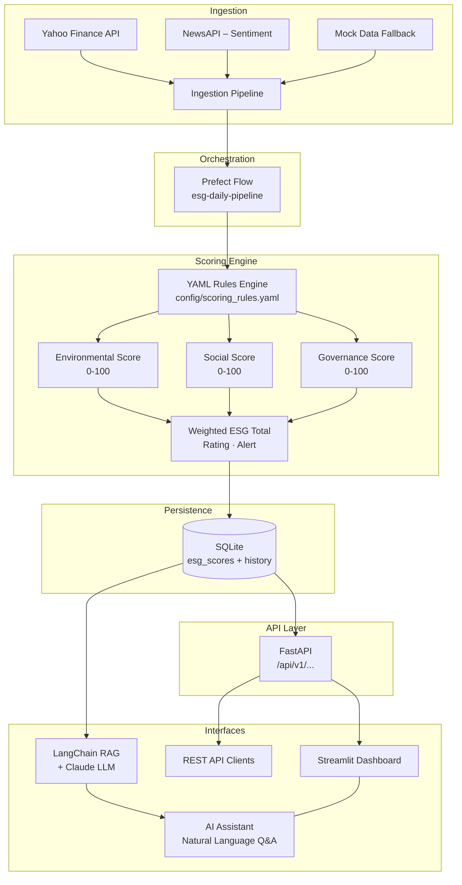

<div align="center">

# 🌿 ESG Workflow

**An end-to-end Environmental, Social & Governance scoring pipeline**  
*Data ingestion · Automated scoring · REST API · Interactive dashboard · AI-powered Q&A*

[](https://github.com/RohithBalachandran76/ESG_workflow/actions)
[](https://www.python.org/downloads/)
[](https://fastapi.tiangolo.com)
[](https://prefect.io)
[](https://streamlit.io)
[](https://www.docker.com)
[](LICENSE)

</div>

---

## Overview

**ESG Workflow** is a production-grade data pipeline that automates the collection, scoring, and reporting of Environmental, Social, and Governance (ESG) metrics for publicly traded companies.

Aligned with the **EU CSRD / ESRS framework**, it ingests data from Yahoo Finance and NewsAPI, computes weighted pillar scores using a fully configurable YAML rules engine, persists results to SQLite, surfaces alerts for at-risk companies, and provides a natural-language Q&A interface powered by **Claude** (Anthropic) via a **LangChain RAG** layer.

Built to demonstrate end-to-end data engineering, ML-adjacent AI integration, and sustainability domain knowledge — the combination increasingly demanded by ESG, fintech, and climate-tech employers.

---

## Architecture



---

## Key Features

| Feature | Description |
|---|---|
| **CSRD/ESRS-aligned scoring** | Weighted E, S, G pillars with 15 metrics; benchmarks match EU reporting standards |
| **Configurable rules engine** | All weights, benchmarks & alert thresholds live in `config/scoring_rules.yaml` — no code changes needed |
| **Real + mock data** | Yahoo Finance (live) enriched with NewsAPI sentiment; robust mock fallback for all tickers |
| **Prefect orchestration** | Typed `@flow` / `@task` DAG with retries — runs on demand or on schedule |
| **FastAPI REST API** | Full CRUD for scores, alerts, history, live scoring, and pipeline trigger |
| **Streamlit dashboard** | 5-page interactive UI: overview, company deep-dive, alerts, AI assistant, pipeline runner |
| **LangChain + Claude RAG** | Ask questions like *"Which company has the worst carbon intensity?"* in plain English |
| **Alert system** | `CRITICAL` (<30) and `WATCH` (<45) thresholds trigger automatic flagging |
| **Score history** | Every pipeline run appended to history table — trend charts out of the box |
| **Docker-ready** | Single `docker compose up` starts API + dashboard |
| **CI/CD** | GitHub Actions: lint (ruff) → pytest (24 tests) → docker build on every push |

---

## Tech Stack

| Layer | Technology |
|---|---|
| Language | Python 3.11 |
| API Backend | FastAPI + Uvicorn |
| Orchestration | Prefect 2 |
| Dashboard | Streamlit + Plotly |
| LLM / RAG | LangChain + Anthropic Claude (`claude-sonnet-4-6`) |
| Vector Store | ChromaDB |
| Data Sources | yfinance · NewsAPI · mock JSON |
| ORM / DB | SQLAlchemy + SQLite |
| Containerisation | Docker + docker-compose |
| Linting | Ruff |
| Testing | pytest · httpx · unittest.mock |
| CI | GitHub Actions |

---

## Project Structure

```
ESG_workflow/
│
├── config/
│   └── scoring_rules.yaml       # ESG scoring weights, benchmarks & alert thresholds
│
├── data/
│   └── mock/
│       └── companies.json       # Seed data: AAPL, MSFT, XOM, NESN, RIO
│
├── src/
│   ├── ingestion/
│   │   ├── pipeline.py          # Unified ingestion: live → mock fallback
│   │   ├── finance_fetcher.py   # Yahoo Finance adapter
│   │   ├── news_fetcher.py      # NewsAPI sentiment scorer
│   │   └── mock_loader.py       # JSON mock data loader
│   │
│   ├── scoring/
│   │   ├── engine.py            # Core scoring logic (normalise → weight → aggregate)
│   │   ├── models.py            # SQLAlchemy ORM models
│   │   └── database.py          # Engine + session factory
│   │
│   ├── workflow/
│   │   └── esg_flow.py          # Prefect flow: ingest → score → persist → alert
│   │
│   ├── api/
│   │   ├── main.py              # FastAPI app + lifespan
│   │   ├── routes.py            # All API endpoints
│   │   └── schemas.py           # Pydantic request/response models
│   │
│   ├── rag/
│   │   ├── chain.py             # LangChain RetrievalQA chain (Claude LLM)
│   │   └── documents.py         # DB → LangChain Document builder
│   │
│   └── dashboard/
│       └── app.py               # Streamlit multi-page dashboard
│
├── tests/
│   ├── conftest.py              # Prefect mock + temp DB fixtures
│   ├── test_scoring_engine.py   # Unit tests for scoring logic
│   ├── test_ingestion.py        # Unit tests for data ingestion
│   └── test_api.py              # Integration tests for all API endpoints
│
├── .github/
│   └── workflows/
│       └── ci.yml               # Lint → Test → Docker build pipeline
│
├── Dockerfile
├── docker-compose.yml
├── requirements.txt
└── .env.example
```

---

## Quick Start

### Option 1 — Local (Python)

```bash
# 1. Clone and set up environment
git clone https://github.com/RohithBalachandran76/ESG_workflow.git
cd ESG_workflow
python -m venv .venv && source .venv/bin/activate   # Windows: .venv\Scripts\activate
pip install -r requirements.txt

# 2. Configure API keys (optional — mock data works without them)
cp .env.example .env
# Edit .env and add your keys (see Configuration section below)

# 3. Seed the database by running the pipeline
python -m src.workflow.esg_flow

# 4a. Start the API server
uvicorn src.api.main:app --reload
# → API docs at http://localhost:8000/docs

# 4b. Start the dashboard (separate terminal)
streamlit run src/dashboard/app.py
# → Dashboard at http://localhost:8501
```

### Option 2 — Docker

```bash
cp .env.example .env        # add your API keys (optional)
docker compose up           # starts API + dashboard

# To also run the pipeline (seeds the database):
docker compose --profile pipeline up pipeline
```

| Service | URL |
|---|---|
| Streamlit Dashboard | http://localhost:8501 |
| FastAPI (Swagger UI) | http://localhost:8000/docs |

---

## Configuration

All ESG scoring logic is controlled by **`config/scoring_rules.yaml`** — no Python code changes required.

```yaml
weights:
  environmental: 0.40   # E pillar weight
  social: 0.35          # S pillar weight
  governance: 0.25      # G pillar weight

thresholds:
  excellent: 75         # score ≥ 75 → "Excellent"
  good: 55
  fair: 35
  poor: 0

alerts:
  critical_breach: 30   # score < 30 → CRITICAL alert
  watch_list: 45        # score < 45 → WATCH alert

pillars:
  environmental:
    metrics:
      carbon_intensity:
        weight: 0.30
        direction: lower_is_better
        benchmarks: { excellent: 50, good: 150, fair: 300, poor: 500 }
      renewable_energy_pct:
        weight: 0.25
        direction: higher_is_better
        benchmarks: { excellent: 80, good: 50, fair: 25, poor: 0 }
      # ... 13 more metrics across E, S, G
```

### Environment Variables

| Variable | Required | Description |
|---|---|---|
| `ANTHROPIC_API_KEY` | For RAG/AI features | Claude API key |
| `NEWS_API_KEY` | Optional | NewsAPI key for live sentiment |
| `DATABASE_URL` | Auto-set in Docker | SQLite path (default: `sqlite:///./esg_workflow.db`) |

---

## API Reference

| Method | Endpoint | Description |
|---|---|---|
| `GET` | `/api/v1/companies` | List all companies with ESG scores |
| `GET` | `/api/v1/companies/{ticker}` | Get score for one company |
| `GET` | `/api/v1/companies/{ticker}/history` | Score history (trend data) |
| `GET` | `/api/v1/alerts` | All active CRITICAL / WATCH alerts |
| `POST` | `/api/v1/score/live` | Score a company in real-time (no DB write) |
| `POST` | `/api/v1/pipeline/run` | Trigger the full pipeline |
| `POST` | `/api/v1/rag/query` | Natural language ESG question |

**Example — live score:**
```bash
curl -X POST "http://localhost:8000/api/v1/score/live?ticker=AAPL"
```
```json
{
  "ticker": "AAPL",
  "company_name": "Apple Inc.",
  "environmental": 88.5,
  "social": 79.2,
  "governance": 81.0,
  "total": 83.4,
  "rating": "Excellent",
  "alert": null
}
```

**Example — AI assistant:**
```bash
curl -X POST "http://localhost:8000/api/v1/rag/query" \
  -H "Content-Type: application/json" \
  -d '{"question": "Which company has the highest governance score and why?"}'
```

---

## ESG Framework Alignment

| Pillar | Metrics Tracked | CSRD/ESRS Reference |
|---|---|---|
| **Environmental** | Carbon intensity, renewable energy %, water usage, waste recycling, regulatory fines | ESRS E1, E3 |
| **Social** | Safety rate, gender pay gap, employee turnover, community investment, news sentiment | ESRS S1, S3 |
| **Governance** | Board independence, audit quality, CEO pay ratio, corruption incidents, transparency | ESRS G1 |

This scoring model is inspired by real-world ESG reporting frameworks including **CSRD** (EU Corporate Sustainability Reporting Directive), **ESRS** (European Sustainability Reporting Standards), and **LkSG** (German Supply Chain Act).

---

## Running Tests

```bash
# Run the full test suite
python -m pytest tests/ -v

# Run a specific module
python -m pytest tests/test_scoring_engine.py -v

# Check code quality
python -m ruff check src/ tests/
```

**Test coverage:** 24 tests across scoring engine, ingestion layer, and all API endpoints.

---

## Roadmap

- [ ] Real-time websocket alerts
- [ ] PDF report generation (CSRD-formatted)
- [ ] Additional data sources (Bloomberg ESG, Sustainalytics)
- [ ] Sector-normalised benchmarking
- [ ] Multi-company portfolio analysis
- [ ] Scheduled Prefect deployment (daily cron)

---

## Contributing

Contributions are welcome! See [CONTRIBUTING.md](CONTRIBUTING.md) for guidelines.

---

## License

This project is licensed under the MIT License — see [LICENSE](LICENSE) for details.

---

<div align="center">
  <sub>Built with Python · FastAPI · Prefect · Streamlit · LangChain · Claude</sub>
</div>
